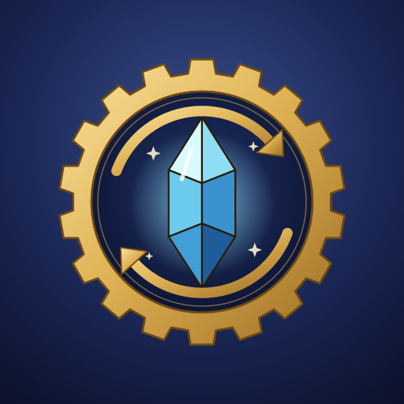
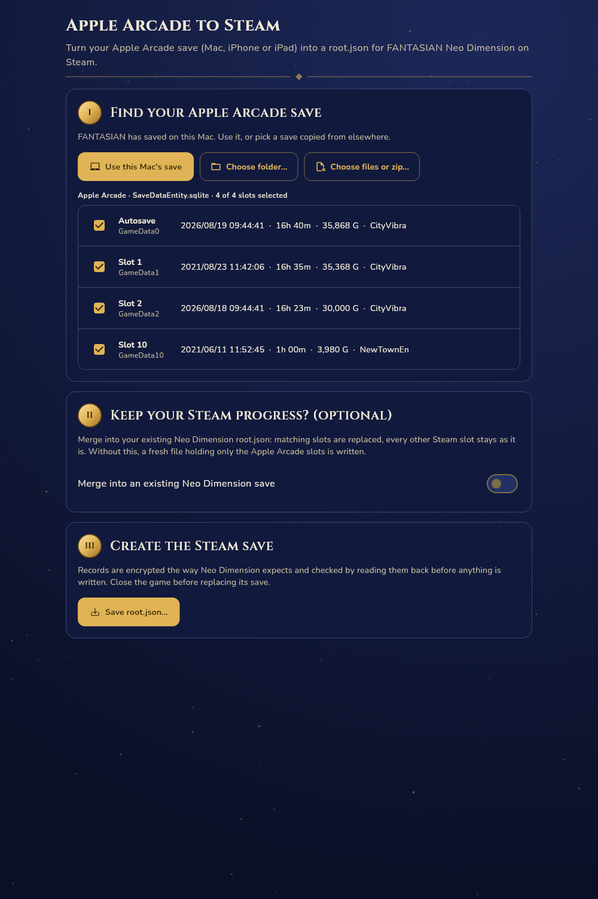
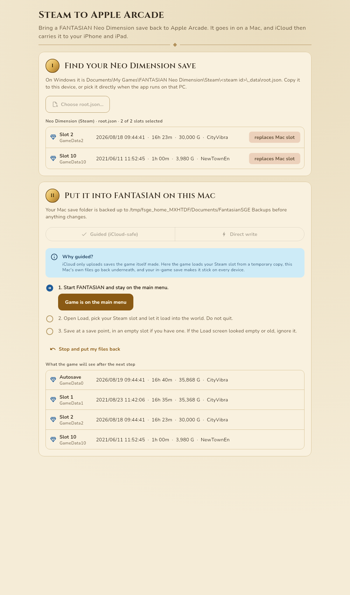
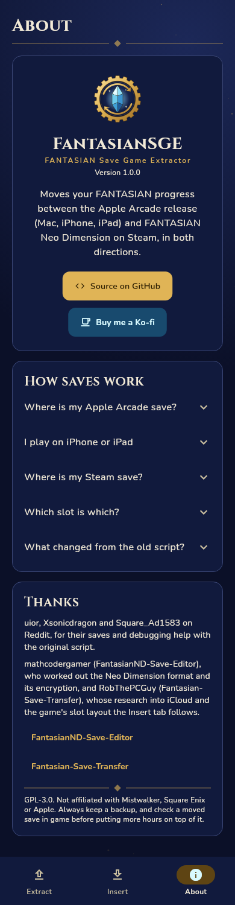

<p align="center">
  
</p>

<h1 align="center">FantasianSGE</h1>

<p align="center">
  Move your <b>FANTASIAN</b> progress between the Apple Arcade release (Mac, iPhone, iPad)<br>
  and <b>FANTASIAN Neo Dimension</b> on Steam, in both directions.
</p>

<p align="center">
  <a href="https://ko-fi.com/pustal">Buy me a Ko-fi ☕</a>
</p>

| Extract (Apple Arcade to Steam) | Insert, guided (Steam to Apple Arcade) | About (phone) |
|---|---|---|
|  |  |  |

## What it does

**Extract: Apple Arcade to Steam.** Reads the Apple Arcade save (`SaveDataEntity.sqlite`
with its `-wal` and `-shm` files), lists every slot with its date, play time, gil and
location, and writes a Neo Dimension `root.json` from the slots you pick. It can merge
into your existing Steam save so the Steam slots you are not replacing stay intact, and on
Windows or Steam Deck it can install the file into the game's save folder directly
(backing up the old one first).

**Insert: Steam to Apple Arcade.** Reads a Neo Dimension `root.json` and puts the slots
you pick into the Apple Arcade game on a Mac. Two ways:

- **Guided (iCloud-safe, recommended).** FANTASIAN syncs saves through iCloud, and iCloud
  only uploads saves the game itself wrote; a file changed from outside gets replaced by
  the cloud copy. So the app has the running game load your Steam slot from a temporary
  copy, puts the Mac's own files back underneath, and you save in game. That save syncs
  to your iPhone and iPad like any other.
- **Direct write.** Writes the slots straight into the database. Use it only when
  iCloud is off for the game or the Mac is offline.

On other platforms the Insert tab can build a patched copy of a save folder (as a zip)
for anyone restoring files by hand.

The original shell script, [`FantasianSGE.sh`](FantasianSGE.sh), is still here and
untouched.

## Platforms

| | Read Apple Arcade save in place | Write Apple Arcade save | Find/install Steam save | Convert picked files |
|---|---|---|---|---|
| macOS | ✅ | ✅ guided or direct | | ✅ |
| Windows | | | ✅ | ✅ |
| Linux / Steam Deck | | | ✅ | ✅ |
| iOS / iPadOS | | | | ✅ via Files |

### About iPhone and iPad

iOS keeps each app's files private, so no app can open FANTASIAN's save on an iPhone.
The game syncs through iCloud, though, and the same Apple Arcade subscription covers the
Mac version. The dependable route is: install FANTASIAN on a Mac signed in to the same
Apple Account, launch it once so the save downloads, and run FantasianSGE there. Inserting
works the same way in reverse: the guided insert's in-game save reaches the iPhone through
iCloud. On iOS the app still converts files you bring to it through the Files app (a zip
of the FANTASIAN folder, or a `root.json`).

## Where the saves live

| Release | Location |
|---|---|
| Apple Arcade (macOS) | `~/Library/Containers/com.mistwalkercorp.fantasian/Data/Library/Application Support/FANTASIAN/` |
| Neo Dimension (Windows) | `Documents\My Games\FANTASIAN Neo Dimension\Steam\<steam id>\_data\root.json` |
| Neo Dimension (Steam Deck) | `~/.local/share/Steam/steamapps/compatdata/2844850/pfx/drive_c/users/steamuser/Documents/My Games/FANTASIAN Neo Dimension/Steam/<steam id>/_data/root.json` |

`GameData0` is the autosave; `GameData1` to `GameData10` are Slots 1 to 10.

## How the formats differ

| | Apple Arcade | Neo Dimension |
|---|---|---|
| File | `SaveDataEntity.sqlite` (Core Data), table `ZGAMEDATAENTITY`, column `ZDATA` | `_data/root.json` |
| Container | zlib-compressed `{"records":[{"path","dataString"}]}` | `{"dataString":"{\"records\":[{\"path\",\"encryptedString\"}]}", ...}` |
| Each slot | plain JSON | AES-128-CBC + PKCS#7, then base64 |

The slot JSON inside is the same in both. FantasianSGE 0.1 (the script) wrote the slots
unencrypted, which the current Neo Dimension no longer reads; the app writes the encrypted
form and can still open files the script produced.

## Building

Requires Flutter 3.47 or newer.

```sh
flutter pub get
flutter run -d macos          # or: windows, linux, or an iOS device/simulator
flutter build macos --release
```

- **macOS:** the app sandbox is turned off (see `macos/Runner/*.entitlements`) because
  the app must reach another app's container and check whether the game is running. The
  first time it touches the save folder, macOS may ask to allow access to data from other
  apps. Distribute it as a notarised download, not through the Mac App Store.
- **iOS:** open `ios/Runner.xcworkspace` in Xcode, choose your team, and run.
- **Icons:** the logo is generated by `tool/generate_logo.py`; `tool/render_icons.sh`
  renders every platform's icons from it.

### Tests

```sh
flutter analyze
flutter test
# Optional cross-check against the Python Fantasian-Save-Transfer tool:
FANTASIAN_REF_TOOL=/path/to/fantasian.py flutter test test/interop
# Refresh the README screenshots:
SCREENSHOTS=1 flutter test test/ui --update-goldens
```

The tests cover the AES implementation against NIST vectors, reading live saves whose
progress only exists in the `-wal`, never modifying files that are only read, merges,
the guided insert end to end, and byte-identical output with the reference Python tool.

## Project layout

```
lib/
  main.dart
  src/core/        save formats, file handling, transfer procedures (no Flutter)
  src/ui/          theme, widgets, controllers, screens
test/              unit, widget and interop tests
tool/              logo and icon generation
FantasianSGE.sh    the original script
```

## Thanks

- uior, Xsonicdragon and Square_Ad1583 on Reddit, for providing data and helping debug
  the original script.
- [mathcodergamer/FantasianND-Save-Editor](https://github.com/mathcodergamer/FantasianND-Save-Editor),
  which worked out the Neo Dimension format and its encryption.
- [RobThePCGuy/Fantasian-Save-Transfer](https://github.com/RobThePCGuy/Fantasian-Save-Transfer),
  whose research into iCloud, the slot layout and the guided insert this app follows.

If this helped you, please consider [buying me a Ko-fi](https://ko-fi.com/pustal).

## License

GPL-3.0, see [LICENSE](LICENSE). Not affiliated with Mistwalker, Square Enix or Apple.
Back up your saves, and check a moved save in game before playing on.
